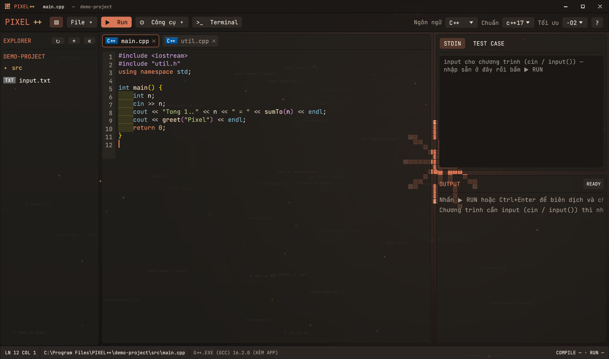

# PIXEL++

**IDE C++ / Python phong cách pixel cho Windows** — viết code, biên dịch, chạy và chấm test ngay trong một cửa sổ, chạy offline hoàn toàn.

## Tải về

👉 **[Tải bản mới nhất (.msi)](https://github.com/hongquang699/PIXELPP/releases/latest)**

Nhấp đúp file `PIXEL++-x.y.z.msi` để cài. App được cài vào `Program Files\PIXEL++`, tự tạo shortcut ở Start Menu và Desktop. Gỡ trong **Settings ▸ Apps**.

**Yêu cầu:** Windows 10/11 64-bit. Không cần cài thêm gì cho C++: bộ cài (~165 MB) đã kèm bộ công cụ [w64devkit](https://github.com/skeeto/w64devkit) đầy đủ và [clangd](https://clangd.llvm.org/). Muốn chạy Python thì máy cần có Python 3.

Cập nhật: tải bản `.msi` mới và cài đè. Cài đặt của bạn (theme, font, test case, tab đang mở…) nằm ở `%APPDATA%\PIXEL++` nên vẫn giữ nguyên.

## Điểm nổi bật

- **App native, nhẹ:** một file exe khoảng 10 MB, không dùng trình duyệt, Electron hay WebView2. Giao diện vẽ bằng card đồ hoạ.
- **Bấm RUN gần như tức thì:** app biên dịch sẵn ở nền khi bạn ngừng gõ, kèm precompiled header cho `<bits/stdc++.h>`. Chạy lại cùng code thì không biên dịch lại.
- **C++11 → C++23** với g++ thật, chọn mức tối ưu -O0 → -O3. **Python 3** chạy trực tiếp, không cần biên dịch.
- **Bộ công cụ đầy đủ đi kèm** (w64devkit 2.11.0): g++ 16.2, gdb 18.1 để debug, make, cmake, vim và các lệnh Unix của busybox. Tất cả dùng được ngay trong TERMINAL của app.
- **STDIN → OUTPUT:** nhập input sẵn, xem cout (cerr tô đỏ), exit code và thời gian chạy.
- **Test case kiểu chấm bài:** nhiều bộ input và output mong đợi, chấm AC / WA / TLE / RE, chỉ ra dòng sai đầu tiên.
- **Lỗi biên dịch tô đỏ đúng dòng.** Bấm vào lỗi để nhảy tới file và dòng đó.
- **Gợi ý code C++ hiểu code thật** (clangd đi kèm): thứ hợp với chỗ con trỏ được xếp lên đầu — trong `int x = ` biến kiểu `int` đứng trước, sau `v.` chỉ hiện thành viên đúng kiểu (kể cả template, `auto`). Chọn hàm là có sẵn ô điền tham số, Tab để nhảy ô. Gõ trong `(…)` hiện chữ ký hàm, đúng overload và đúng tham số đang gõ.
- **Gợi ý code Python** và mô tả tiếng Việt cho thư viện chuẩn, kèm snippet; hiểu cả class và hàm bạn tự viết.
- **Snippet** có sẵn cho lập trình thi đấu (`fori`, `main`, `cp`, `tc`, `readv`, `modpow`…).
- **TERMINAL tích hợp** (PowerShell / Command Prompt) và nút **CHẠY FILE** để nhập `cin` / `input()` trực tiếp.
- **Quản lý file như IDE:** nhiều tab, cây Explorer, mở folder để biên dịch nhiều file `.cpp` / `.h` cùng lúc, tìm / thay thế, comment nhiều dòng, căn lề.
- **Tô màu thụt lề (indent rainbow):** mỗi cấp thụt lề một màu, chỗ thụt lệch tô đỏ.
- **17 theme pixel** có cảnh động phía sau (Synthwave, Aurora, Phố mưa đêm, Hội An, Hà Nội, TP. Hồ Chí Minh…), mỗi theme một bảng màu code riêng. Có nút tắt cảnh nền.
- **15 font** lưu sẵn (pixel và font lập trình), chỉnh cỡ chữ, phóng to / thu nhỏ cả giao diện.
- **Nhiều cửa sổ**, nhớ tab, folder, STDIN và test case giữa các lần mở.

## Phím tắt chính

| Phím | Việc |
|---|---|
| `Ctrl+Enter` | Chạy |
| `Ctrl+Shift+Enter` | Chấm test |
| `Ctrl+S` / `Ctrl+O` / `Alt+O` | Lưu / mở file / mở folder |
| `Alt+N` / `Shift+Alt+N` | File C++ mới / file Python mới |
| `Ctrl+Space` | Gợi ý code |
| `Ctrl+F` / `Ctrl+H` | Tìm / thay thế |
| `Ctrl+/` | Comment |
| ``Ctrl+` `` | Bật / tắt TERMINAL |
| `Ctrl+B` | Ẩn / hiện Explorer |
| `Ctrl+Shift+N` | Cửa sổ mới |
| `F1` | Bảng toàn bộ phím tắt |

## Phiên bản

Xem ghi chú từng bản ở trang **[Releases](https://github.com/hongquang699/PIXELPP/releases)**.

---

Repo này chỉ phát hành bộ cài của PIXEL++; mã nguồn không công khai.
